# Walkthrough

## Home
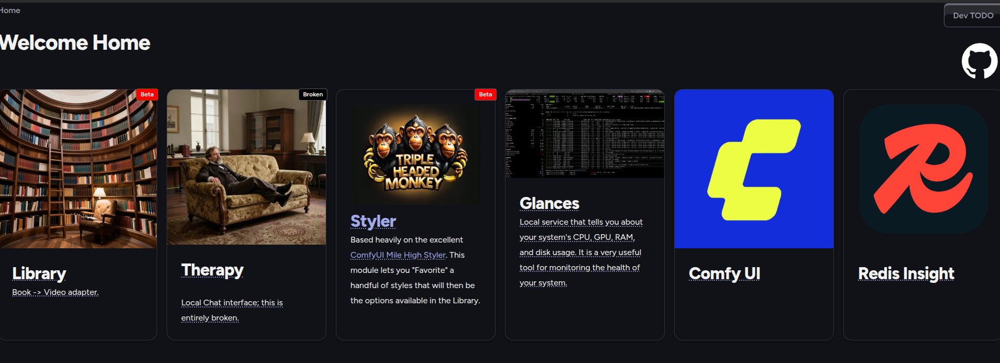

Right now there are six modules.

* Library: Book to Video system
* Therapy: LLM Chat (broken)
* Styler: Partially implimented image style browser/chooser
* Glances: See processes, cpu usage, memory usage, etc..
* Comfy UI: Directly link to comfyui
* Redis Insight: UI for viewing/editing the redis data backend

TODO:  New top level module for our own unique style of Comfy UI template.

For the purposes of this version of this document, we choose "Library".

## Library

My library looks like this right now:

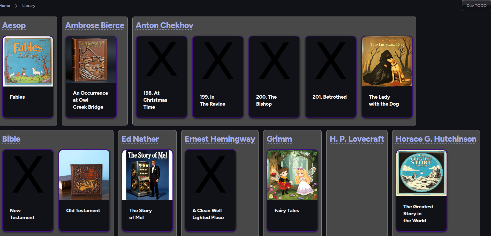

Each author and book on this page is a direct mirror of the contents of the "active" directory.

I will choose "The Story of Mel". 

## Chapter List
The response is the clear design failure of a "chapter selection" interstitial in a single chapter "book".

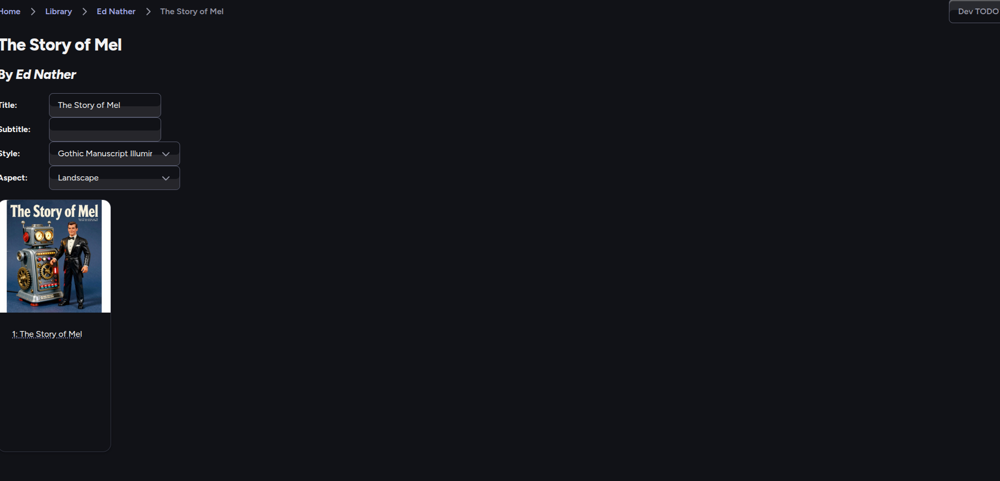

Tough call.  I'll go with chapter 1.

## Text

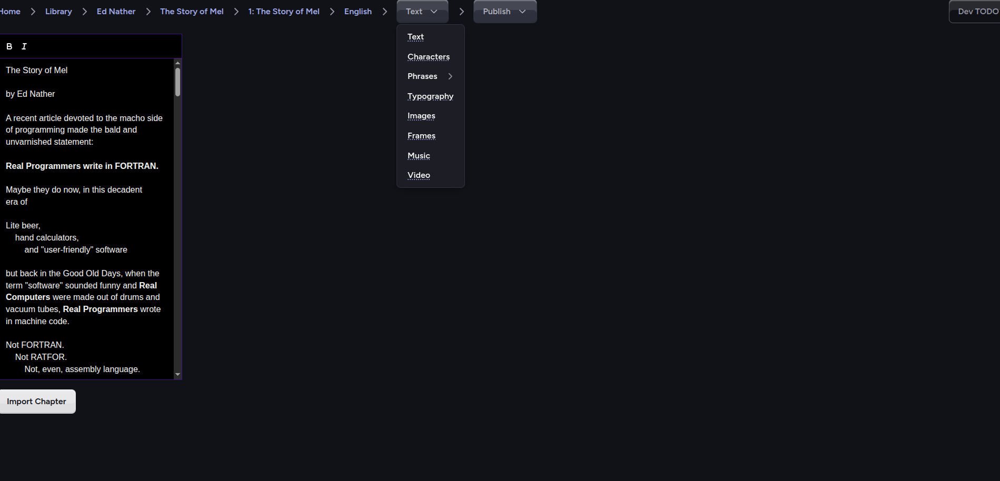

On top you see the base naviation.  

The actual "text" component rich text editor is intentionally narrow. 

It is approximately the width remaining when you've maximized the size of a square image in a widescreen aspect ratio.  It won't _exactly_ match the rendered LaTeX, but it will be close.  Bold, italic, funny indentation, etc..  not a lot.

I haven't added any characters so lets drop in on typography next. 

## Typography
I scrolled a bit to put that sloppy mess of LaTeX. into full view in all its horrible glory:

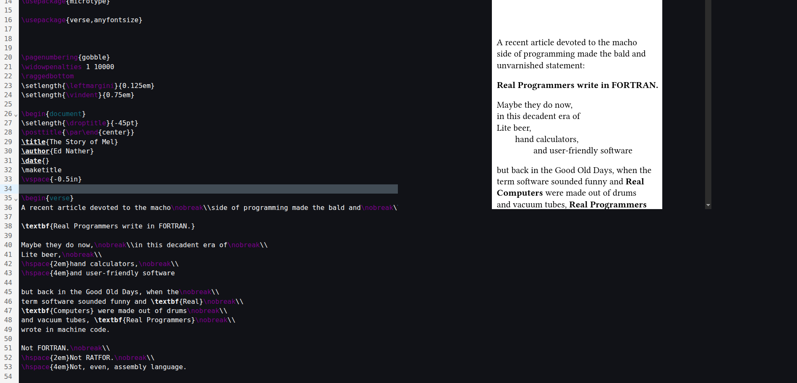

Raw LaTeX. on the left, rendered page on the right.

## Phrases

Three kinds of phrases, its sad the sort of knowledge map level structure that is so sorely missing.

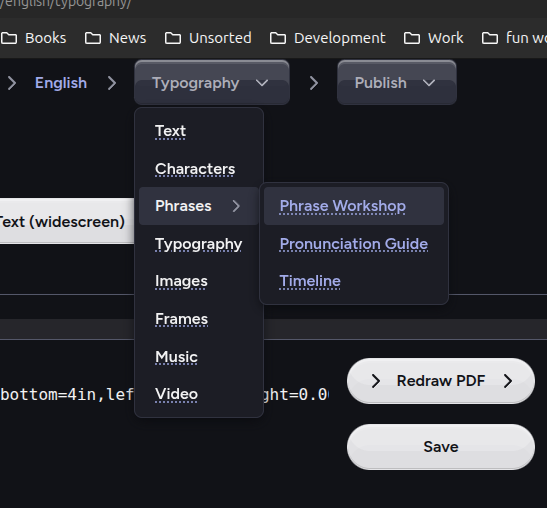

### Phrase Workshop
I like the phrase workshop.  I really do.  This started as the audio only.  The navigation here is by numbered paragraph.  Here we have the opening image, the text from the story, the person speaking and the pronunciation of what they are saying.

More on pronunciations in a moment.

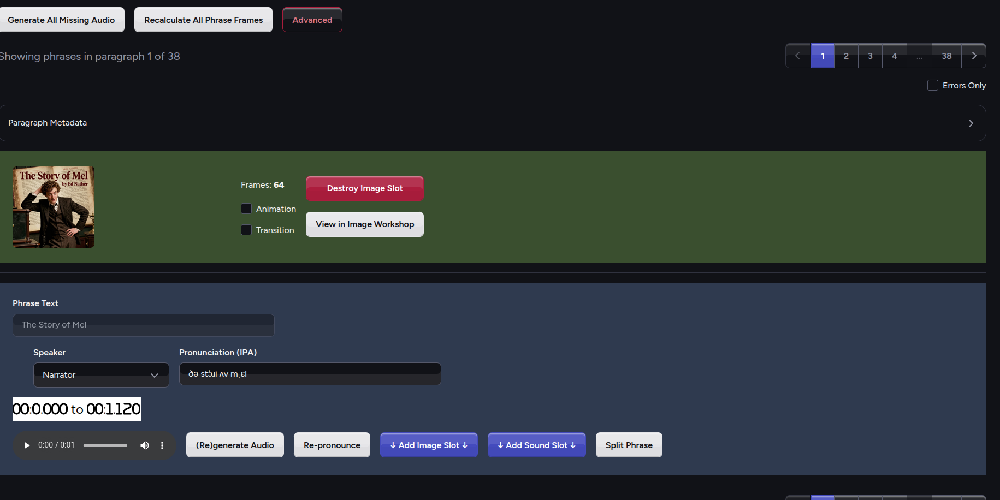

a few paragraphs later where the actual text picks up.

The layout is still weak.  We are presenting the `raw text`, the latex, the rendered latex, the choice of speaker and the editable IPA pronunciation of the `raw text`.
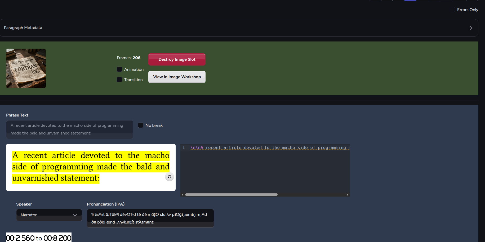
### Pronunciation Guide
This includes some awesome.
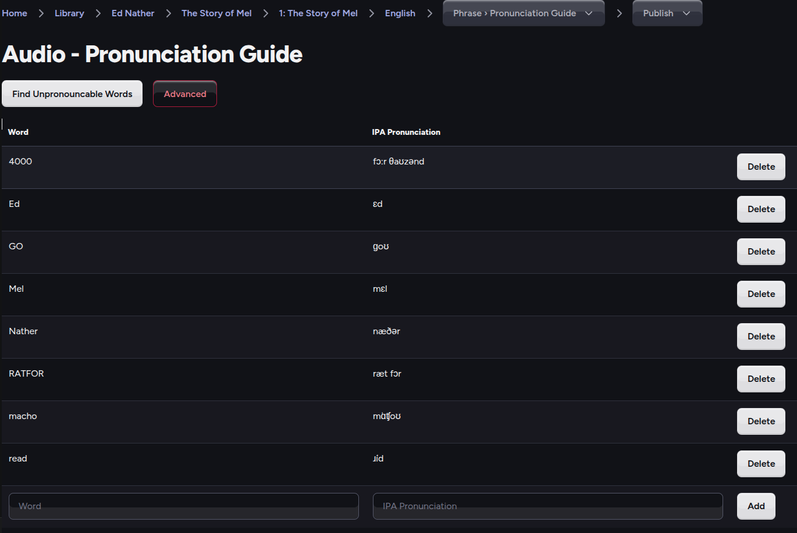

Word as it appears in the text with a coresponding override for how to pronounce it.  Stupid simple little webform, I know, right?

But expand one of them:
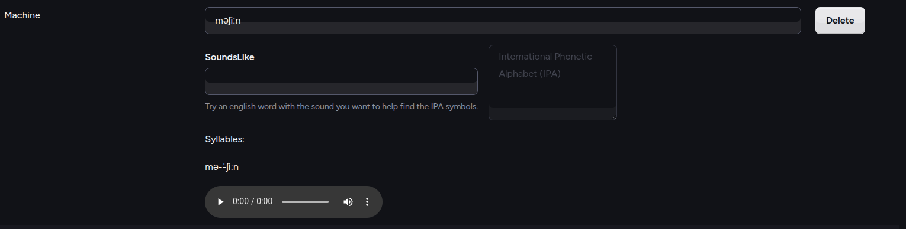
<audio controls src="assets/Machine.wav"><audio>

if I type words into "SoundsLike", I get those word the way the system guesses is correct.

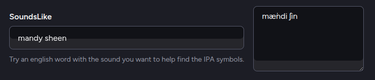

I can drop that pronunciation in to overwrite the old one.  Then it generates the thing I was trying to fix:

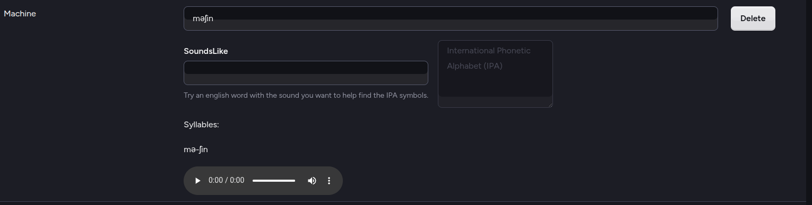
<audio controls src="assets/Machine_Worse.wav"><audio>

SoundsLike is also great for building up a word if you don't know IPA very well.  Ask it for words that have common syllables with the word you want (like "mandy sheen"), snip off the IPA for one bit at a time.  It's very intuitive.

There are character set problems between the IPA that comes out of Eng-to-IPA and what works as input for kokuru.  but.. it may be self inflicted as the round-trip from a user copy and pasting one unicode string to another is a likely culprit.

If it seems like it is ignoring the characters you are using try characters from:

https://westonruter.github.io/ipa-chart/keyboard/

[Investigation and Resolution of "Machine" pronunciation problem](release_notes_001.md)

Walkthrough TODO:

### Timeline
## Images
### Image
#### Viewer
#### Selector
#### Editor
#### Scene
#### Prompt
#### Upload
#### Citation
### Camera
### Transition
### Animation
## Frames
## Music
## Video